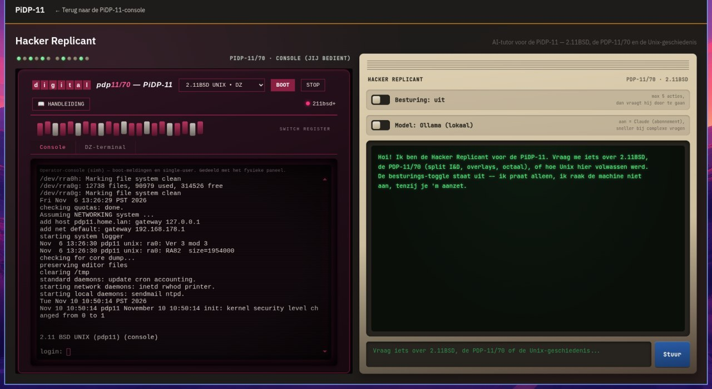

# PiDP-11 Hacker Replicant

An AI tutor/copilot that sits next to Oscar Vermeulen's PiDP-11 replica: a
web page with the real operator console on the left, and a chat panel on
the right that knows 2.11BSD (plus RT-11, RSX-11M+, RSTS/E, and Unix v1-v7)
— and, if you let it, can type into the console itself.

This is a **complete package**: the web console that drives the machine
(left panel), the small bridge that lets the chat agent read/type into it,
and the chat backend itself (right panel) are all included. If your Pi
already runs Oscar's standard PiDP-11 software (the `/opt/pidp11/...`
toolchain — boot images, `pidp11.sh`, the `screen` session), this should
work with no code changes, just configuration.

This is the first "Hacker Replicant" packaged for the community. It's part
of a small family built for different PDP/VAX/HP replicas; this one is
PiDP-11-specific, but the pattern (web console + a tiny `screen`-reading
boot-API + a chat panel + an LLM backend) is reusable for other machines too.



## How it works

```
Browser
 │
 ├─ Left panel:  <iframe> → webconsole/app.py (FastAPI, :8080, included)
 │      /ws/console → pty <-> `screen -x pidp11` (the simh operator console)
 │      /ws/dz      → telnet bridge to the DZ11 login line (127.0.0.1:4000)
 │      boot/stop    → the standard /opt/pidp11/bin/pidp11.sh toolchain
 │
 └─ Right panel: chat → POST /api/chat (SSE stream)
      │  this Node service (server.js)
      │
      ├─ LLM backend: any OpenAI-compatible /chat/completions API
      │  (local Ollama by default, or a hosted provider -- see below)
      │
      └─ when the control toggle is ON, two tools only:
           send_keys   → POST  <BOOTAPI_BASE>/keys    {"text": "..."}
           read_screen → GET   <BOOTAPI_BASE>/screen
           (served by pidp11-bootapi.py, included in this repo)
```

There's no SIMH API involved anywhere. The machine's console runs inside a
GNU `screen` session named `pidp11`; both the web console and the chat
agent's tools talk to that *same* session, just via two different
mechanisms:

- The **web console** (`webconsole/app.py`) attaches a real pty to it via
  `screen -x pidp11` and streams raw bytes over a WebSocket to an
  [xterm.js](https://xtermjs.org/) terminal in the browser — this is what
  gives you full interactive use (the left panel).
- The **chat agent's tools** (`pidp11-bootapi.py`) use two simpler,
  stateless `screen` primitives instead, since the agent only needs to type
  and read back, not hold an interactive session open:
  - `screen -X stuff <text>` — types text into the session, as if someone
    sat down and typed it.
  - `screen -X hardcopy <file>` — writes a plain-text snapshot of the
    current screen contents to a file, which the API reads back.

That's the entire "control" surface for the agent: no shell access, no
filesystem access, nothing beyond what's visible in the same terminal the
web console already shows.

## LLM-agnostic by design

The chat backend talks to **any backend that speaks the OpenAI-compatible
`/chat/completions` API with tool/function calling** — that's one code
path for both:

- **Local** (default, free): point it at a local [Ollama](https://ollama.com)
  install. Ollama has spoken this API since mid-2024, nothing extra to
  configure beyond pulling a model that supports tool calling (`qwen3`,
  `llama3.1`+, `mistral-nemo`, etc. all do).
- **Cloud** (optional, for a faster/smarter option): point it at OpenAI,
  Groq, Together, Fireworks, DeepSeek, Mistral, OpenRouter, a hosted
  vLLM/TGI endpoint — anything OpenAI-compatible. See `.env.example` for
  examples.

No vendor SDK, no hard dependency on any single provider, no API key
required at all if you only use the local backend.

## Setup

### Prerequisites

- A PiDP-11 running Oscar Vermeulen's standard software image (SIMH under
  `/opt/pidp11/`, boot images in `/opt/pidp11/systems/`, the `pidp11.sh`
  launcher). If `screen -ls` shows a `pidp11` session and
  `/opt/pidp11/systems/selections` exists, you have what `webconsole/`
  needs.
- Node.js 18+ and Python 3 (with `venv`) on that same host.
- [Ollama](https://ollama.com) running somewhere reachable (for the free
  local backend), or an API key for a cloud provider.

All three pieces (web console, boot-API, chat backend) are plain
Python/Node processes — they can run on the PiDP-11's own Pi, or the chat
backend can run elsewhere and just point `CONSOLE_URL`/`BOOTAPI_BASE` at the
Pi over the network. The web console and boot-API need to run on the Pi
itself (they both shell out to `screen`/`pidp11.sh` directly).

### Install

```bash
git clone <this-repo-url>
cd pidp11-hacker-replicant
npm install
cp .env.example .env
# edit .env: at minimum set CONSOLE_URL and BOOTAPI_BASE to match your setup
```

### Run the web console (on the Pi, left panel)

```bash
cd webconsole
python3 -m venv venv
venv/bin/pip install -r requirements.txt
venv/bin/python -m uvicorn app:app --host 0.0.0.0 --port 8080
```

### Run the boot-API (on the Pi, bridges the chat agent to the console)

```bash
python3 pidp11-bootapi.py
```

Edit the `SESSION` constant at the top of `pidp11-bootapi.py` if your
`screen` session isn't named `pidp11`.

### Run the chat backend (right panel)

```bash
npm start
```

Open `http://<host>:8100/` (or whatever `PORT` you set) — `CONSOLE_URL`
should point at the web console you started above (e.g.
`http://<pi-host>:8080`).

### Running all three as services

See `docs/pidp11-webconsole.service.example`,
`docs/pidp11-bootapi.service.example`, and
`docs/pidp11-hacker-replicant.service.example` for ready-to-adapt systemd
units.

## Configuration reference

All configuration is environment variables — see `.env.example` for the
full list with examples. The short version:

| Variable | What |
|---|---|
| `PORT` | Port the chat backend listens on |
| `CONSOLE_URL` | Your existing web console, shown in the left panel |
| `BOOTAPI_BASE` | Where `pidp11-bootapi.py` is reachable |
| `ACTION_LIMIT` | Tool calls per turn before the agent must ask to continue |
| `LOCAL_BASE_URL` / `LOCAL_API_KEY` / `LOCAL_MODEL` | Local (default) backend |
| `CLOUD_BASE_URL` / `CLOUD_API_KEY` / `CLOUD_MODEL` | Optional cloud backend |

## Safety model

- The control toggle is **off** on every page load — by default the agent
  only talks, it never touches the machine.
- When on, the agent gets exactly two tools (`send_keys`, `read_screen`),
  nothing else — no shell, no filesystem, no network access beyond the
  boot-API.
- After `ACTION_LIMIT` tool calls in one turn, the agent is cut off from
  further tool calls and must ask in plain text whether it may continue —
  no silent, unbounded action streak. A hard iteration cap (20) sits
  underneath as a defensive backstop against a broken loop.
- Everything the agent types is visible live in the same terminal session
  your own web console shows — no black box.
- This does **not** protect you from the agent typing something wrong (it's
  an LLM, it can make mistakes) — the boundary is on *what* it can touch,
  not on *how well* it types. Use a local/free backend if you want to
  experiment without any cost risk.

## Repository layout

```
server.js              Chat backend (Node/Express, SSE, LLM-agnostic)
public/                 Chat panel UI (right side)
pidp11-bootapi.py       screen -X stuff/hardcopy bridge for the chat agent's tools
skills/bsd-tutor.md     System prompt: PDP-11/2.11BSD knowledge + behavior rules
webconsole/             Web console (left side) -- FastAPI app + xterm.js UI
  app.py
  static/index.html
  requirements.txt
docs/                   Example systemd units (not installed automatically)
```

## Adapting this for a different replica

`pidp11-bootapi.py` is deliberately small and machine-specific only in its
`SESSION` name and `status()` heuristic — it's a reasonable starting point
for wiring up the same pattern on a different PDP/VAX/HP/whatever replica:
same two primitives (`screen -X stuff` / `screen -X hardcopy`), same tiny
HTTP wrapper. `skills/bsd-tutor.md` is the only file that's actually
PDP-11/2.11BSD-specific content; swap it for a system prompt about your own
machine and point `server.js` at the new file.

`webconsole/app.py` is more machine-specific — it assumes Oscar's standard
PiDP-11 toolchain layout (`/opt/pidp11/systems/`, `pidp11.sh`, the DZ11 mux
on port 4000). For a different replica you'd likely swap this for whatever
web console that machine already has (most PiDP replicas ship with
something along these lines), and just point `CONSOLE_URL` at it — the chat
panel and the boot-API don't care what's actually driving the left panel.

## Credits

Built by Rolf Peters with Seb (his homelab AI assistant), in collaboration
with Oscar Vermeulen (designer of the PiDP replica series). Inspired by
Oscar's own `agent-pdp1` project for the PiDP-1.

## License

MIT — see `LICENSE`.
